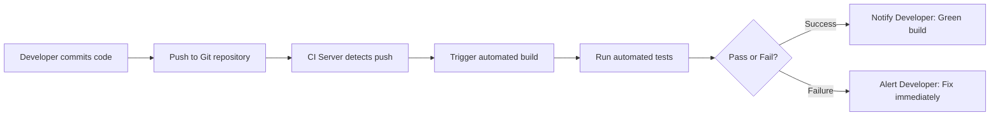

# Exercise: Introduction to Continuous Integration (CI) and Jenkins Installation

## 1. What is Continuous Integration (CI)?
**Continuous Integration (CI)** is a software engineering practice where developers regularly integrate their code changes into a shared version-controlled repository (often several times a day). Each integration is automatically verified by automated builds and automated test suites, allowing teams to identify and resolve defects early in the lifecycle.

---

## 2. Key Features of CI
- **Frequent Code Integration**: Developers commit small chunks of code frequently, reducing divergence between branches.
- **Automated Builds**: Every commit triggers an automated build to ensure compilation and dependency resolution succeed.
- **Automated Testing**: Unit, integration, and security tests run automatically against the newly built artifacts.
- **Immediate Feedback**: Developers are instantly notified when a build or test fails, allowing immediate fixes before errors reach downstream environments.

---

## 3. Benefits of CI
- **Early Bug Detection**: Bugs and integration regressions are detected immediately, significantly lowering bug-fixing costs.
- **Improved Collaboration**: Smooth, continuous integration prevents "merge hell" when multiple developers work simultaneously.
- **Faster Delivery Cycles**: Automated validation removes manual build overhead, accelerating release cadences.
- **High Code Quality**: Continuous regression tests ensure consistent code health and compliance with team standards.

---

## 4. How CI Works (Workflow)


---

## 5. Top 10 CI Tools Comparison

| Tool | Deployment Model | Key Highlights | Best Used For |
|---|---|---|---|
| **Jenkins** | Self-hosted / Open Source | Massive plugin ecosystem (>1,800 plugins), highly customizable, distributed builds | Custom enterprise pipelines & self-hosted infrastructure |
| **GitLab CI/CD** | Cloud / Self-hosted | Built into GitLab, YAML-based pipelines, Auto DevOps | Teams using GitLab for version control |
| **GitHub Actions** | Cloud / Self-hosted runners | Deep native integration with GitHub, extensive Actions Marketplace | Projects hosted on GitHub |
| **CircleCI** | Cloud / Self-hosted | Native Docker execution, parallelism, fast caching | Containerized workflows and fast feedback cycles |
| **Travis CI** | Cloud | Simple YAML configs, popular in open-source projects | Open-source libraries and small teams |
| **Azure DevOps** | Cloud / Self-hosted | Multi-platform build agents (Windows, Linux, macOS), Azure integration | Enterprise teams in the Microsoft/Azure ecosystem |
| **TeamCity** | Server / Cloud | Intelligent build analysis, JetBrains integration, pre-tested commits | Complex enterprise projects needing advanced analytics |
| **Bamboo** | Server | Deep native integration with Jira, Bitbucket, and Confluence | Teams invested in the Atlassian stack |
| **Drone** | Container-native | Every step runs in an ephemeral Docker container | Lightweight, Docker-first environments |
| **Spinnaker** | Multi-cloud CD | Advanced release strategies (Canary, Blue-Green), multi-cloud deployment | Cloud-native Continuous Delivery |

---

## 6. Key Jenkins Concepts
- **Job / Project**: A defined task or sequence of steps that Jenkins executes.
- **Build**: An execution instance of a job (compiling, testing, or packaging).
- **Pipeline**: A suite of plugins supporting the implementation and integration of continuous delivery pipelines via code (`Jenkinsfile`).
- **Plugins**: Community or vendor extensions adding integrations (e.g. Git, Docker, Kubernetes, Slack).
- **Nodes & Agents**: Execution machines where build workloads run (Master/Controller coordinates, Agents execute).

---

## 7. Jenkins Installation on Docker & Verification

### Step 1: Run Jenkins Container
```powershell
docker run -d --name jenkins -p 8080:8080 -p 50000:50000 -v jenkins_home:/var/jenkins_home jenkins/jenkins:lts
```
- **Port `8080`**: Exposed web user interface.
- **Port `50000`**: JNLP inbound build agent communication port.
- **Volume `jenkins_home`**: Persistent volume for jobs, configs, and plugins.

### Step 2: Retrieve Initial Admin Password
```powershell
docker exec jenkins cat /var/jenkins_home/secrets/initialAdminPassword
```
**Verified Password:**
```
bbb0a530fe8e442489d7f60e65ad31e4
```

### Step 3: Access Jenkins Web Interface
- **URL**: `http://localhost:8080`
- **HTTP Status Code**: `200 OK` (Verified)

---

## 8. Post-Installation Onboarding Steps
1. Navigate to `http://localhost:8080` in your web browser.
2. Enter the initial administrator password retrieved above.
3. Select **"Install suggested plugins"** to install standard plugins (Git, Pipeline, SSH, etc.).
4. Create the First Admin User or continue as Admin.
5. Confirm the Jenkins URL and begin creating jobs.
